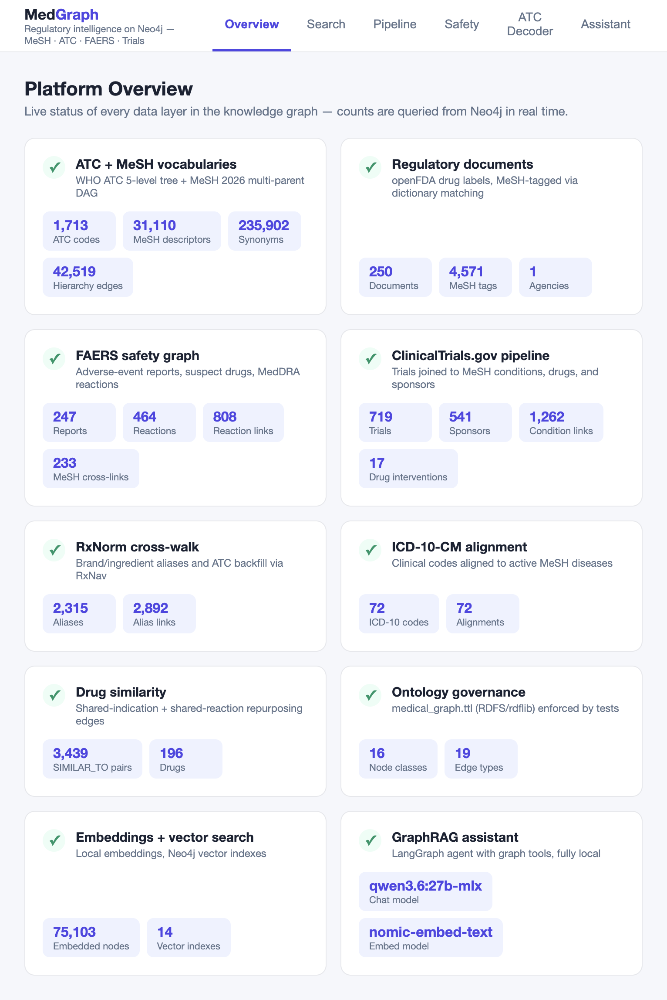
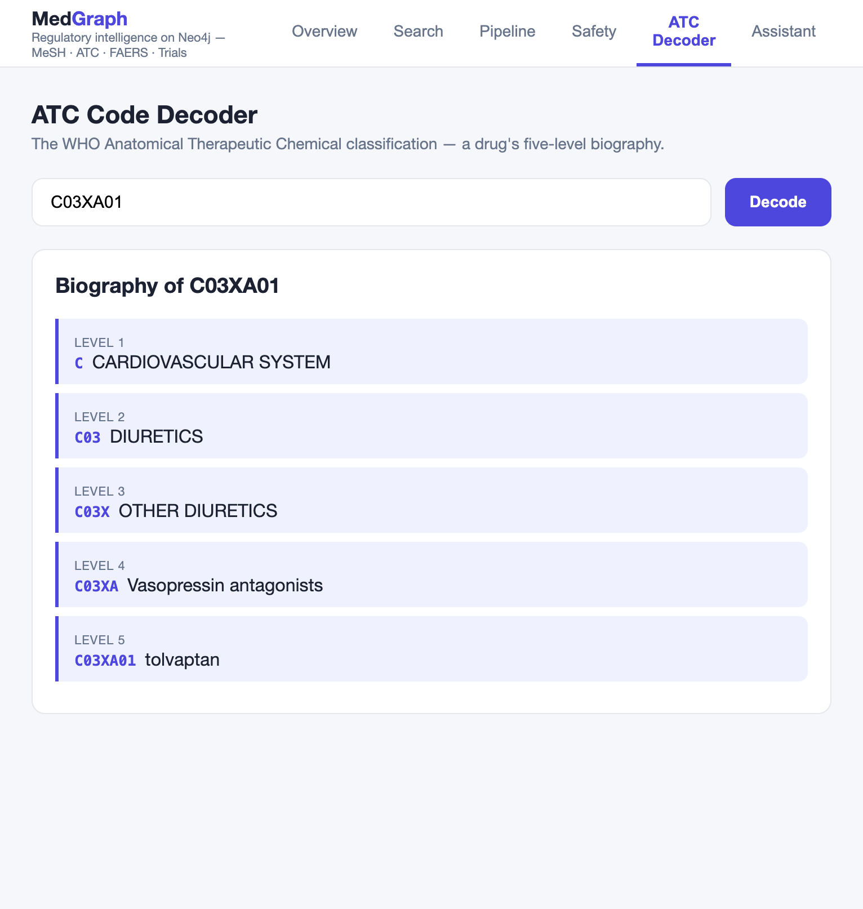
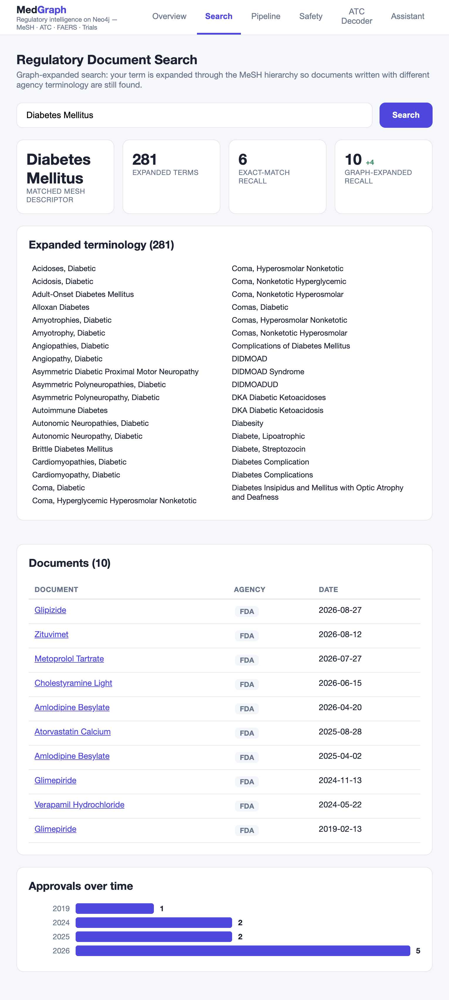
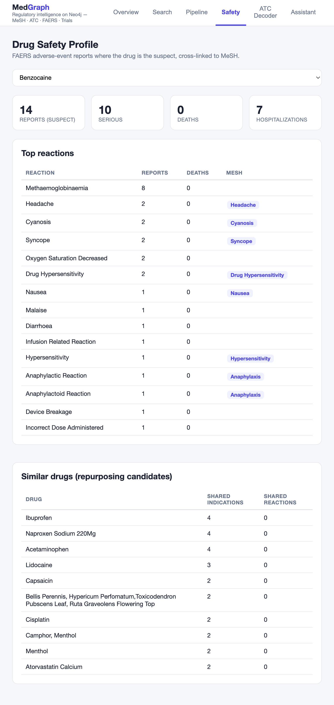
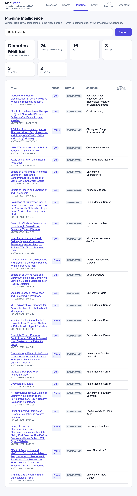
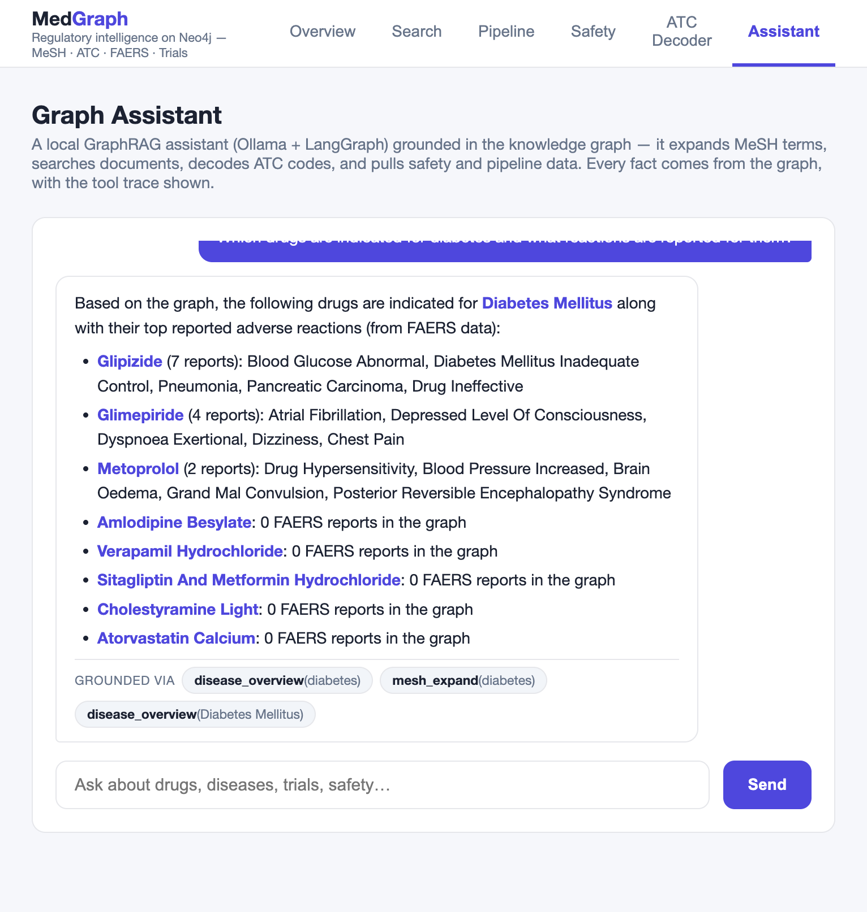
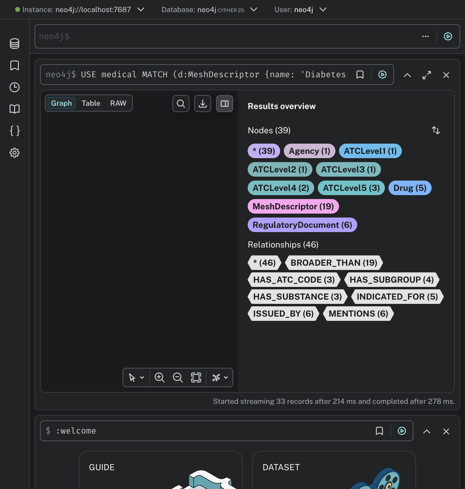

# Building MedGraph: A Regulatory Intelligence Knowledge Graph with Neo4j, LangGraph, and a Fully Local LLM Stack

*How we turned a conference talk about "Enhancing Medical Data Processing with Neo4j" into a working,
extended prototype — with graph-assisted search, a drug-safety layer, clinical-trial pipeline intelligence,
vector search, and a grounded chatbot — all running locally on a laptop.*

---

## The starting point

The inspiration was a talk by a staff software engineer describing **Ria**, a Regulatory Intelligence
Assistant built on a bio-intelligence platform. The production system indexes 2M+ regulatory documents
from 50+ sources across 6–7 agencies (FDA, EMA, TGA, NMPA, PMDA, Health Canada…), and uses Neo4j for two
things:

1. **Decoding ATC codes** — the WHO Anatomical Therapeutic Chemical classification — into a drug's full
   "biography" (e.g. `C03XA01` → Cardiovascular system → Diuretics → … → tolvaptan).
2. **Search-time query expansion** — traversing the MeSH (Medical Subject Headings) hierarchy so that a
   search for "diabetes mellitus" also matches documents using any of its ~281 descendant and synonym
   terms (and for broad terms like "nervous system diseases", on the order of 2,500).

We rebuilt that core architecture — then kept going. This post walks through what **MedGraph** does,
how it's built, and what we learned. All data sources are public and license-free; the entire stack
(including the LLM) runs locally.



## Architecture at a glance

```
WHO ATC index ──┐
NLM MeSH 2026 ──┤        ┌──────────── Neo4j (Desktop, "medical" DB) ───────────┐
openFDA labels ─┤  ETL   │ ATC tree · MeSH DAG · Documents · Drugs · FAERS ·     │
openFDA FAERS ──┼──────► │ Trials · Sponsors · RxNorm aliases · ICD-10 ·         │
ClinicalTrials ─┤ Python │ 2,700→270k vector embeddings                        │
RxNorm / ICD-10 ┘        └──────┬───────────────┬───────────────┬───────────────┘
                                │               │               │
                        FastAPI (REST)   LangGraph agent   Neo4j Browser
                                │        (Ollama qwen3.6)   (deep links)
                          React dashboard (Vite)  +  Streamlit demo
```

Everything is Python 3.12 on the backend (`neo4j` driver, `rdflib`, FastAPI, LangChain/LangGraph),
React + Vite on the frontend, and Ollama serving `nomic-embed-text` (embeddings) and `qwen3.6:27b-mlx`
(chat) locally.

## Layer 1 — The vocabulary backbone: ATC + MeSH

**ATC** is a fixed 5-level tree. We crawl the public WHOCC index (politely, with disk caching) and load
it as labeled levels:

```cypher
MATCH path = (l1:ATCLevel1)-[:HAS_SUBGROUP|HAS_SUBSTANCE*..4]->(l5:ATCLevel5 {code: 'C03XA01'})
RETURN [n IN nodes(path) | toString(n.level) + ': ' + n.code + ' — ' + n.name] AS breakdown
-- 1: C — CARDIOVASCULAR SYSTEM
-- 2: C03 — DIURETICS
-- 3: C03X — OTHER DIURETICS
-- 4: C03XA — Vasopressin antagonists
-- 5: C03XA01 — tolvaptan
```

**MeSH** is where a graph earns its keep: it's *not* a tree. Diabetes Mellitus lives under both
*Nutritional and Metabolic Diseases* (`C18.452.394.750`) **and** *Endocrine System Diseases* (`C19.246`).
We parse the 2026 MeSH XML (313 MB), derive `BROADER_THAN` edges from tree-number prefixes, and load
31,110 descriptors, 235,902 entry terms, and 42,519 hierarchy edges as a multi-parent DAG.



## Layer 2 — Graph-assisted search expansion

The talk's core trick, reproduced: a user term is resolved against a full-text index, then expanded to
all descendants + synonyms in a single traversal:

```cypher
CALL db.index.fulltext.queryNodes('meshNames', $term) YIELD node, score
WITH node ORDER BY score DESC LIMIT 1
OPTIONAL MATCH (node)-[:SYNONYM_OF]->(d0:MeshDescriptor)
WITH coalesce(d0, node) AS start
OPTIONAL MATCH (start)<-[:SYNONYM_OF]-(syn:MeshTerm)
OPTIONAL MATCH path = (start)-[:BROADER_THAN*1..13]->(child:MeshDescriptor) ...
```

"Diabetes Mellitus" → 281 terms, including every branch the talk mentions (Type 1, Type 2,
Diabetes Complications → Diabetic Angiopathies → Diabetic Foot / Diabetic Retinopathy).
On our 250-document openFDA corpus, that expansion lifts recall from 6 exact-match documents
to 10 (+67%) — terminology differs across writers, and the graph absorbs that.



## Layer 3 — Beyond the talk: safety, pipeline, identity

The talk indexed documents. MedGraph adds three more dimensions, all joined through the same
MeSH/Drug nodes:

**Drug safety (openFDA FAERS).** `(:Drug)-[:HAS_REPORT]->(:AdverseEventReport)-[:REPORTS_REACTION]->(:Reaction)`
— 247 reports, 464 distinct MedDRA reaction terms, and 233 reactions auto-cross-linked to MeSH
descriptors (sometimes through synonyms: "Rash" → *Exanthema*, "Hepatocellular Carcinoma" →
*Carcinoma, Hepatocellular*). One traversal now answers "which reactions are reported for
diabetes-indicated drugs" — indications and safety in the same query.



**Pipeline intelligence (ClinicalTrials.gov).** The v2 API exposes derived condition browse MeSH IDs,
so trials join our descriptors *for free*: 719 trials, 541 sponsors, 1,262 condition links.
"What's approved" (labels) now sits next to "what's coming" (trials).



**Identity resolution (RxNorm + ICD-10-CM).** Users type brand names; agencies write generics.
RxNav gives us 2,315 brand/ingredient aliases (`Duetact → Glimepiride → A10BB12`) plus ATC backfill.
The keyless NLM Clinical Tables API aligns 72 active diseases to ICD-10-CM codes.

## Layer 4 — Graph analytics without GDS

We wanted drug-repurposing signals but didn't want to modify the DBMS with the GDS plugin, so
similarity is computed in pure Cypher — shared MeSH indications plus shared FAERS reaction profiles:

```cypher
MATCH (a:Drug)-[:INDICATED_FOR]->(m:MeshDescriptor)<-[:INDICATED_FOR]-(b:Drug)
WHERE elementId(a) < elementId(b)
WITH a, b, count(DISTINCT m) AS sharedInd WHERE sharedInd >= 2
OPTIONAL MATCH (a)<-[:HAS_REPORT]-(:AdverseEventReport)-[:REPORTS_REACTION]->(x:Reaction)
               <-[:REPORTS_REACTION]-(:AdverseEventReport)-[:HAS_REPORT]->(b)
WITH a, b, sharedInd, count(DISTINCT x) AS sharedRxn
MERGE (a)-[e:SIMILAR_TO]-(b)
SET e.sharedIndications = sharedInd, e.sharedReactions = sharedRxn, e.score = sharedInd*2 + sharedRxn
```

3,439 similarity pairs — a poor-man's repurposing candidate list, zero plugins required.

## Layer 5 — Vectors + graph: the GraphRAG half

Every text-bearing node class is embedded with local `nomic-embed-text` into per-label Neo4j vector
indexes (14 indexes; 270k+ nodes once the full run finishes — drugs, aliases, documents, reactions,
all 31k descriptors, all 236k synonyms, trials, sponsors, ATC levels). Semantic queries now land on the
graph: a fuzzy phrase maps to the nearest MeSH term, reaction, or trial — and from there, one hop
reaches structured facts.

## Layer 6 — A grounded chatbot (LangGraph + Ollama)

The **Assistant** is a LangGraph ReAct agent over local `qwen3.6:27b-mlx` with nine tools:
`disease_overview` (disease → drugs → reactions in one deterministic Cypher pass), `mesh_expand`,
`search_documents`, `drug_safety`, `trials_pipeline`, `decode_atc`, `similar_drugs`,
`semantic_search` (via LangChain's `Neo4jVector`), and `graph_qa` — LangChain's
`GraphCypherQAChain` for ad-hoc questions, which generates Cypher over the live-introspected schema:

```
Q: "How many clinical trials are in the graph and which sponsor has the most?"
Generated Cypher:
  MATCH (t:Trial) WITH count(t) AS totalTrials
  MATCH (s:Sponsor)<-[:SPONSORED_BY]-(tr:Trial)
  RETURN totalTrials, s.name AS sponsorWithMost, count(tr) AS maxTrials
  ORDER BY maxTrials DESC LIMIT 1
A: "There are 719 clinical trials in the graph, and Boehringer Ingelheim has the most."
```



**Lesson learned the hard way:** we started with `llama3.2:3b`. It invented a Mongo-style filter DSL
inside tool arguments and then hallucinated NCT trial numbers. The fixes were (1) a model that actually
supports tool calling, (2) a composite tool that collapses multi-hop questions into one deterministic
Cypher pass instead of relying on agent chaining, and (3) a system prompt with hard grounding rules —
no invented names, IDs, or statistics; say when the graph has no data.

## Layer 7 — Ontology as governance

Every node label and relationship type is declared once in `ontology/medical_graph.ttl` (RDFS, parsed
with rdflib). A pytest suite scans the entire codebase and **fails the build if any Cypher string uses
a label or edge type the ontology doesn't declare**. The `/stats` endpoint that powers the Overview
dashboard enumerates classes from the ontology too — add a layer to the TTL and it shows up in stats
automatically.

## Exploring the raw graph

Neo4j Browser deep links (`?cmd=edit&arg=USE medical …`) are embedded throughout, so any view is one
click from an interactive graph. The ego-network query below fans out from one disease to its subtree,
synonyms, drugs, ATC chains, documents, and agency — 39 nodes streamed in 278 ms:



## What we'd do next

- Scale the document corpus (the real Ria runs 2M+ documents — that belongs in a search engine with
  Neo4j holding vocabulary + links).
- ChEMBL for drug → target → mechanism-of-action; UMLS (free license) as the master cross-walk.
- MedDRA, once licensed, to give reactions a hierarchy.
- GDS plugin for proper community detection and PageRank per therapeutic area.
- Scheduled `etl.watch` runs to diff new approvals weekly.

## Try it

```bash
git clone https://github.com/akashgoyal-ux/MedicalDatawithNoe4j.git
cd MedicalDatawithNoe4j
python3.12 -m venv .venv && .venv/bin/pip install -r requirements.txt
cp .env.example .env   # set NEO4J_PASSWORD
# loaders: etl.load_atc / load_mesh / ingest_openfda / ingest_faers / ingest_trials /
#          load_rxnorm / load_icd / compute_similarity / embed_nodes
.venv/bin/uvicorn api.main:app --port 8000
cd web && npm install && npm run dev    # dashboard on :5173
```

*Data sources: WHOCC ATC/DDD Index · NLM MeSH 2026 · openFDA (labels, FAERS) · ClinicalTrials.gov ·
RxNorm/RxNav · NLM Clinical Tables ICD-10-CM — all public. Models: local via Ollama.*
