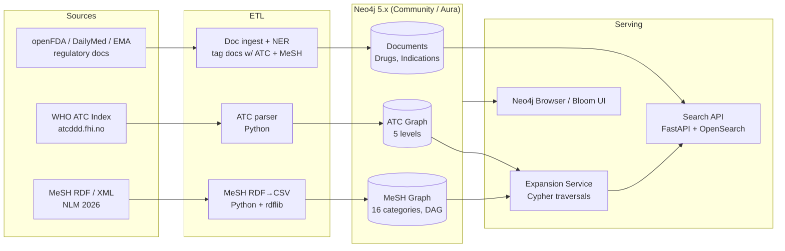

# Implementation Plan — Enhancing Medical Data Processing with Neo4j

> Based on the analysis of the video: **https://www.youtube.com/watch?v=6JMMip1FTxY**
> ("Enhancing Medical Data Processing with Neo4j" — talk by a staff software engineer
> building a Regulatory Intelligence Assistant, "Ria", on a bio-intelligence platform)
>
> Date: 2026-10-30

---

## 1. Video Analysis Summary

### 1.1 What the speaker built
The speaker's team built **Ria (Regulatory Intelligence Assistant)**, a pharma-domain
search and research tool that:

- Indexes **2M+ publicly available regulatory documents** from **50+ data sources**
  covering **6–7 regulatory agencies** (US FDA, EMA, Australia TGA, China NMPA,
  Japan PMDA, Health Canada, and EU bodies).
- Lets users search, curate, filter, summarize, and analyze regulatory data to
  accelerate drug-development strategy.
- Uses **Neo4j** as a graph database to model two key pharma vocabularies:
  - **ATC classification** (Anatomical Therapeutic Chemical) — a fixed 5-level hierarchy.
  - **MeSH headings** (Medical Subject Headings) — a large disease/term hierarchy.
- Uses the graph for **synonym/child-term expansion at search time**: when a user
  searches "diabetes mellitus" or "nervous system diseases", the system traverses the
  graph and expands the query to all descendant terms (up to ~2,500 synonyms for
  "nervous system diseases" per the talk) so documents written with different
  terminology by different agencies are still found.

### 1.2 Problems Neo4j solved (per the talk)
| Problem | Flat-file / relational approach | Graph approach used |
|---|---|---|
| Decode an ATC code (e.g. `C03XA01`) into its meaning | Scan a file of all codes per lookup — slow | Traverse a 5-level labeled graph: L1 → L5, low latency |
| Find all synonyms/child terms of a disease for search | Recursive scans over 2,000+ nodes per disease category | Single Cypher traversal of `HAS_CHILD` / tree relationships |
| Multi-agency terminology mismatch | Exact string match misses results | Expand query against MeSH graph before hitting the document index |

### 1.3 ASR note (transcript cleanup)
The auto-transcript garbles several names. Corrections applied in this plan:
- "Topton" / "12f10" → **tolvaptan**, ATC code **C03XA01**
  (C = Cardiovascular system → 03 = Diuretics → X = Vasopressin antagonists → A01 = tolvaptan).
- "diabetes malus / meletus / mtis" → **Diabetes Mellitus**.
- The platform/company name is garbled ("vvpr", "w.ai", "vpro"); referred to here as *the platform*.

---

## 2. Goal of This Implementation

Build a working replica of the architecture presented in the talk:

1. Load the **WHO ATC classification** into Neo4j as a 5-level tree.
2. Load **NLM MeSH descriptors + tree hierarchy** into Neo4j as a multi-parent graph.
3. Ingest a realistic corpus of **public regulatory documents** (FDA openFDA,
   Drugs@FDA, DailyMed, EMA) tagged with ATC codes and MeSH terms.
4. Implement **graph-assisted search expansion**: user term → graph traversal →
   expanded term set → document retrieval.
5. Expose the result via a small API + optional Neo4j Bloom/Browser exploration.

---

## 3. Real Data Sources (verified links & facts)

### 3.1 ATC classification — WHO Collaborating Centre for Drug Statistics Methodology
- **Official index:** https://atcddd.fhi.no/atc_ddd_index/ (ATC/DDD Index 2026,
  maintained by the Norwegian Institute of Public Health for WHO; last updated 2026-01-20).
- **Structure (verified from who.int):**
  - **14 main anatomical/pharmacological groups** at Level 1:
    `A` Alimentary tract & metabolism, `B` Blood & blood forming organs,
    `C` Cardiovascular system, `D` Dermatologicals, `G` Genito-urinary system &
    sex hormones, `H` Systemic hormonal preparations (excl. sex hormones & insulins),
    `J` Antiinfectives for systemic use, `L` Antineoplastic & immunomodulating agents,
    `M` Musculo-skeletal system, `N` Nervous system, `P` Antiparasitic products,
    `R` Respiratory system, `S` Sensory organs, `V` Various.
  - **5 levels:** L1 anatomical main group (1 letter) → L2 therapeutic subgroup
    (2 digits) → L3 pharmacological subgroup (1 letter) → L4 chemical subgroup
    (1 letter) → L5 chemical substance (2 digits).
  - Worked example from who.int: **metformin = A10BA02**; worked example from the
    talk: **tolvaptan = C03XA01**.
  - One medicinal product gets one ATC code per route of administration/strength;
    combination products get separate codes.
- **Getting the data:** searchable online; a downloadable/printed ATC Index and
  Guidelines can be ordered via https://orders.atcddd.fhi.no/. For a build like
  this, scrape the public index pages (respecting the copyright/disclaimer) or
  key in the subset you need; open mirrors of ATC→name mappings also exist in
  openFDA's `drugsfda` data and RxNorm cross-references.

### 3.2 MeSH — US National Library of Medicine
- **Home:** https://www.nlm.nih.gov/mesh/meshhome.html
- **Downloads:** https://www.nlm.nih.gov/databases/download/mesh.html
  — **2026 MeSH files are in production** (XML, ASCII, and RDF formats).
- **RDF + SPARQL:** MeSH is published as RDF at https://id.nlm.nih.gov/mesh/
  with a public SPARQL query editor (https://id.nlm.nih.gov/mesh/query) and an
  open MeSH API — this is the cleanest machine-readable source for the graph build.
- **Browser:** https://meshb.nlm.nih.gov/ (shows 2026 vocabulary; preview of 2027).
- **Structure (verified from nlm.nih.gov/mesh/intro_trees.html):**
  - Descriptors organized in **16 top-level categories** (A = Anatomy,
    B = Organisms, **C = Diseases**, **D = Chemicals and Drugs**, etc.).
  - Hierarchy up to **13 levels deep**; a descriptor can appear in **multiple tree
    locations** (multi-parent graph — exactly why a graph DB fits better than a tree).
  - Example used in the talk — **Diabetes Mellitus** sits under both
    *Nutritional and Metabolic Diseases* (tree no. `C18.452.394.750`) and
    *Endocrine System Diseases* (tree no. `C19.246`), with children like
    Diabetes Mellitus Type 1/Type 2 and branches like Diabetes Complications →
    Diabetic Angiopathies → Diabetic Foot / Diabetic Retinopathy.
- **Scale:** ~30,000 descriptors plus entry terms (synonyms) and 250k+ Supplementary
  Concept Records — consistent with the talk's "350,000+ words" claim.

### 3.3 Regulatory documents & drug data (public, free)
| Source | What you get | Link |
|---|---|---|
| openFDA API | `drug/drugsfda.json` (approvals), `drug/label.json` (SPL labels w/ indications), `drug/drugsfda` incl. submission docs | https://open.fda.gov/apis/ |
| DailyMed (NLM) | Full FDA drug labels (SPL XML), indications, active ingredients | https://dailymed.nlm.nih.gov/dailymed/about.cfm |
| Drugs@FDA | Approval history, review documents | https://www.accessdata.fda.gov/scripts/cder/daf/ |
| EMA | European Public Assessment Reports (EPARs) | https://www.ema.europa.eu/en/medicines |
| PubMed/PMC | Biomedical literature already MeSH-indexed (free MeSH tagging training/validation data) | https://pubmed.ncbi.nlm.nih.gov/ |
| RxNorm (NLM) | Drug name normalization, cross-links to ATC | https://www.nlm.nih.gov/research/umls/rxnorm/ |

Licensing note: MeSH XML/RDF download is free; the full UMLS Metathesaurus
requires a (free) UMLS license. ATC data is public with WHOCC copyright terms —
fine for internal/R&D use.

### 3.4 Neo4j platform
- **Neo4j Community Edition** (free, self-hosted) is sufficient for this workload
  (vocabularies are < 1M nodes). Download: https://neo4j.com/download/
- **Neo4j Aura** (managed cloud) has a free tier suitable for prototyping:
  https://neo4j.com/product/auradb/
- **Drivers:** official Python/JavaScript/Java drivers; **APOC** library for ETL
  helpers; **Neo4j Browser/Bloom** for the visual exploration shown in the talk.

---

## 4. Architecture



---

## 5. Graph Data Model

### 5.1 Nodes
| Label | Key properties | Source |
|---|---|---|
| `ATCLevel1` … `ATCLevel5` | `code`, `name`, `level` | WHO ATC |
| `Drug` | `name` (INN), `atcCode`, `synonyms[]` | ATC L5 + RxNorm/DailyMed |
| `MeshDescriptor` | `ui` (e.g. `D003920` = Diabetes Mellitus), `name`, `treeNumbers[]` | MeSH RDF |
| `MeshTerm` | `name` (entry terms / synonyms), `descriptorUi` | MeSH RDF |
| `RegulatoryDocument` | `docId`, `agency` (FDA/EMA/…), `title`, `date`, `url` | openFDA/EMA |
| `Agency`, `TherapeuticArea` | `name` | derived |

### 5.2 Relationships
```
(:ATCLevel1)-[:HAS_SUBGROUP]->(:ATCLevel2)-[:HAS_SUBGROUP]->(:ATCLevel3)
(:ATCLevel3)-[:HAS_SUBGROUP]->(:ATCLevel4)-[:HAS_SUBSTANCE]->(:ATCLevel5)
(:ATCLevel5)-[:CLASSIFIES]->(:Drug)

(:MeshDescriptor)-[:BROADER_THAN]->(:MeshDescriptor)      // from tree numbers
(:MeshTerm)-[:SYNONYM_OF]->(:MeshDescriptor)

(:Drug)-[:HAS_ATC_CODE]->(:ATCLevel5)
(:Drug)-[:INDICATED_FOR]->(:MeshDescriptor)
(:RegulatoryDocument)-[:MENTIONS]->(:MeshDescriptor)
(:RegulatoryDocument)-[:ABOUT]->(:Drug)
(:RegulatoryDocument)-[:ISSUED_BY]->(:Agency)
```

Important: model MeSH as a **DAG, not a tree** — one descriptor has multiple
`treeNumbers` (e.g. Diabetes Mellitus = `C18.452.394.750` **and** `C19.246`), so
each tree location yields a `BROADER_THAN` edge to the corresponding parent.

### 5.3 Constraints & indexes
```cypher
CREATE CONSTRAINT atc_code IF NOT EXISTS
FOR (n:ATCLevel5) REQUIRE n.code IS UNIQUE;
CREATE CONSTRAINT mesh_ui IF NOT EXISTS
FOR (n:MeshDescriptor) REQUIRE n.ui IS UNIQUE;
CREATE CONSTRAINT doc_id IF NOT EXISTS
FOR (n:RegulatoryDocument) REQUIRE n.docId IS UNIQUE;
CREATE FULLTEXT INDEX meshNames IF NOT EXISTS
FOR (n:MeshDescriptor|MeshTerm) ON EACH [n.name];
CREATE FULLTEXT INDEX drugNames IF NOT EXISTS
FOR (n:Drug) ON EACH [n.name, n.synonyms];
```

---

## 6. Core Cypher Queries (the ones the talk demonstrated)

**6.1 Decode an ATC code into its full "biography" (tolvaptan example):**
```cypher
MATCH path = (l1:ATCLevel1)-[:HAS_SUBGROUP*..4]->(l5:ATCLevel5 {code: 'C03XA01'})
RETURN [n IN nodes(path) | n.level + ': ' + n.code + ' — ' + n.name] AS breakdown;
-- C: Cardiovascular system → C03: Diuretics → C03X: Vasopressin antagonists
-- → C03XA: (chemical subgroup) → C03XA01: tolvaptan
```

**6.2 Expand a user search term to all MeSH descendants + synonyms:**
```cypher
CALL db.index.fulltext.queryNodes('meshNames', $userTerm) YIELD node AS start
WITH start LIMIT 1
MATCH (start)<-[:SYNONYM_OF]-(syn:MeshTerm)
WITH collect(DISTINCT start.name) + collect(DISTINCT syn.name) AS base, start
MATCH (start)-[:BROADER_THAN*1..13]->(child:MeshDescriptor)
OPTIONAL MATCH (child)<-[:SYNONYM_OF]-(csyn:MeshTerm)
RETURN base + collect(DISTINCT child.name) + collect(DISTINCT csyn.name) AS expandedTerms;
-- For "Nervous System Diseases" this returns on the order of ~2,500 terms,
-- matching the number quoted in the talk.
```

**6.3 Find all documents for an indication, regardless of agency terminology:**
```cypher
// $terms = output of query 6.2
MATCH (d:RegulatoryDocument)-[:MENTIONS]->(m:MeshDescriptor)
WHERE m.name IN $terms
RETURN d.agency, d.title, d.date, d.url
ORDER BY d.date DESC LIMIT 100;
```

**6.4 Find all drugs in a therapeutic class (e.g. all diuretics):**
```cypher
MATCH (l2:ATCLevel2 {code: 'C03'})-[:HAS_SUBGROUP*1..3]->(l5:ATCLevel5)
MATCH (l5)-[:CLASSIFIES]->(drug:Drug)
RETURN l5.code, drug.name;
```

---

## 7. Phased Implementation Plan (realistic: 8–10 weeks, 1–2 engineers)

### Phase 0 — Environment & spike (Week 1)
- [ ] Install Neo4j 5.x Community (Docker: `neo4j:5-community`) or provision Aura Free.
- [ ] Set up Python 3.11+ venv with `neo4j`, `rdflib`, `requests`, `pandas`, `pytest`.
- [ ] Spike: load 10 ATC codes and the Diabetes Mellitus MeSH branch manually;
      run queries 6.1–6.2; confirm latency < 50 ms locally.

### Phase 1 — ATC graph (Week 2)
- [ ] Extract the ATC hierarchy (scrape https://atcddd.fhi.no/atc_ddd_index/ level
      pages, or use the openFDA/RxNorm ATC cross-walk for the ~6k level-5 substances).
- [ ] Emit `atc_nodes.csv` (code, name, level) + `atc_edges.csv` (child → parent).
- [ ] Bulk load with `LOAD CSV` / `neo4j-admin database import`; add constraints.
- [ ] Acceptance: query 6.1 returns the correct 5-level path for C03XA01 and A10BA02.

### Phase 2 — MeSH graph (Weeks 3–4)
- [ ] Download **2026 MeSH** from https://www.nlm.nih.gov/databases/download/mesh.html
      (XML: `desc2026.xml`) **or** pull the RDF dump from
      https://nlmpubs.nlm.nih.gov/projects/mesh/rdf/ — RDF is preferred (SPARQL-able,
      explicit `broaderTransitive` and `treeNumber` relations).
- [ ] Parse descriptors, tree numbers, and entry terms into CSV/Parquet staging.
- [ ] Derive `BROADER_THAN` edges from tree-number prefixes (a descriptor's parent =
      tree number with the last segment dropped); handle the **multi-parent** case
      (multiple tree numbers → multiple parents).
- [ ] Load ~30k descriptors + ~300k terms; add constraints and full-text index.
- [ ] Acceptance: "Diabetes Mellitus" expansion returns its known subtree (Type 1,
      Type 2, Diabetes Complications, Diabetic Angiopathies, Diabetic Foot,
      Diabetic Retinopathy); "Nervous System Diseases" expansion count is in the
      low thousands.

### Phase 3 — Document ingestion (Weeks 5–6)
- [ ] openFDA: pull `drug/drugsfda` + `drug/label` for a target set (e.g. the 250+
      approved drugs/biologics mentioned in the talk, or all approvals for 3
      therapeutic areas to stay small).
- [ ] DailyMed SPL XML → extract indications section → map to MeSH descriptors
      (dictionary matching against `MeshTerm`/`MeshDescriptor` full-text index).
- [ ] Map active ingredients → ATC L5 codes (via RxNorm→ATC cross-walk or the ATC
      index); create `Drug` nodes + `HAS_ATC_CODE` + `INDICATED_FOR` edges.
- [ ] Acceptance: sample 20 documents manually verified for correct MeSH/ATC tags.

### Phase 4 — Search expansion service (Week 7)
- [ ] FastAPI endpoint `GET /expand?term=...` wrapping query 6.2 (with caching —
      expansions are static per MeSH release; cache in Redis or precompute).
- [ ] Integrate with a document search layer (OpenSearch/Elasticsearch, or
      Neo4j full-text over `RegulatoryDocument` for the MVP): rewrite user query
      as `term OR expandedTerm1 OR ...`.
- [ ] Measure: baseline exact-match recall vs expanded recall on a 50-query
      hand-labeled test set across agencies' terminology.

### Phase 5 — Hardening, UI, demo (Week 8–10)
- [ ] Neo4j Browser/Bloom saved scenes reproducing the talk's demos (ATC traversal
      for tolvaptan; Diabetes Mellitus and Nervous System Diseases expansions).
- [ ] Refresh pipeline: MeSH releases **annually** (2027 files already in preview),
      ATC index updates **twice a year** — make loaders idempotent (`MERGE`-based).
- [ ] Tests: unit (parsers), integration (Cypher against a test container), and
      a latency budget (expansion < 100 ms p95 at 2.5k-term expansions).
- [ ] Docs + runbook; final demo script mirroring the talk's flow.

---

## 8. Risks & Mitigations

| Risk | Mitigation |
|---|---|
| ATC full index isn't a clean open download (WHOCC copyright; ordered product) | Scrape public level pages politely, or use openFDA/RxNorm cross-walks; keep the corpus to needed subsets |
| MeSH multi-parent trees break naive tree code | Model as DAG from day one; derive edges from all tree numbers; test with Diabetes Mellitus |
| Dictionary-based MeSH tagging of documents is noisy | Start with exact/entry-term matching + manual sample audit; add an ML NER/entity-linking pass (e.g. UMLS-based) later |
| Synonym explosion hurts precision (2.5k terms for broad parents) | Cap expansion depth (e.g. 3–5 levels) or weight by graph distance; make depth a query param |
| Annual vocabulary churn invalidates cached expansions | Version nodes by release year (`:MeshDescriptor {year: 2026}`) or rebuild cache on reload |
| Scale creep to 2M documents like the real Ria | Keep documents in a search engine; Neo4j holds only vocab + links (the talk's implied architecture) |

---

## 9. Success Metrics

- **Coverage:** 100% of ATC L1–L5 loaded and path-decodable; ≥ 95% of MeSH
  descriptors loaded with correct parent edges (spot-checked against
  https://meshb.nlm.nih.gov/).
- **Recall:** expanded search finds ≥ 30% more relevant documents than exact-match
  on the labeled test set (terminology varies across FDA/EMA/TGA/PMDA wording).
- **Latency:** graph expansion p95 < 100 ms; end-to-end search p95 < 500 ms.
- **Freshness:** MeSH/ATC reload completes unattended in < 1 hour per release.

---

## 10. References

- Video: https://www.youtube.com/watch?v=6JMMip1FTxY
- WHO ATC classification: https://www.who.int/tools/atc-ddd-toolkit/atc-classification
- WHOCC ATC/DDD Index 2026: https://atcddd.fhi.no/atc_ddd_index/
- NLM MeSH home: https://www.nlm.nih.gov/mesh/meshhome.html
- MeSH tree structures: https://www.nlm.nih.gov/mesh/intro_trees.html
- MeSH downloads (2026): https://www.nlm.nih.gov/databases/download/mesh.html
- MeSH RDF + SPARQL: https://id.nlm.nih.gov/mesh/ and https://id.nlm.nih.gov/mesh/query
- openFDA APIs: https://open.fda.gov/apis/
- DailyMed: https://dailymed.nlm.nih.gov/dailymed/about.cfm
- RxNorm: https://www.nlm.nih.gov/research/umls/rxnorm/
- Neo4j: https://neo4j.com/download/ · https://neo4j.com/product/auradb/
